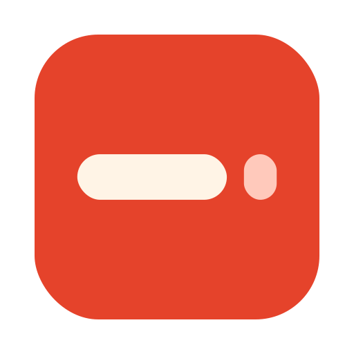

<p align="center">
  
</p>

<h1 align="center">BreakBar</h1>

A macOS menu bar Pomodoro timer with fully custom intervals (I use 45 / 10) and a
**Rest window**: when work ends, a window says "Rest" and the rest timer only starts when you
click **Start resting**.

<p align="center">
  <a href="https://github.com/12amcoffee/BreakBar/releases/latest/download/BreakBar.dmg"><b>⬇️ Download BreakBar for macOS</b></a>
  &nbsp;·&nbsp;
  <a href="https://github.com/12amcoffee/BreakBar/releases/latest">All downloads</a>
  <br>
  <sub>macOS 13 or later · Apple silicon and Intel · free</sub>
</p>

## What's new in 2.0

- **Intervals in the dropdown.** Work, short rest and long rest sit under the Start button as three pills; click one to adjust it with a stepper, or click the number itself and type a value (Return applies, Esc cancels).
- **Warm look.** Cream in light mode and ink in dark mode across the popover, Settings and the Rest windows, with flat tomato buttons.
- **Redrawn Rest windows.** All four styles (small, maximised, banner, full screen) now show session dots, a rest countdown with a progress bar, and a "Break is over" window to start work. The full-screen overlay is a tomato screen in light mode and an ink screen in dark mode.
- **Tidier popover.** The empty gap under "Session 1 of 4" is gone.

## Why I made this

I made BreakBar because of one very normal study session. I was in the library, doing problem sets
on paper, with no earbuds in, and I was using a Pomodoro timer to stay on track. Most timers just
play a sound when your work block ends, which is no good when you're trying to be quiet in a library
(or you just don't have headphones on). The timer I'd been using showed a proper "Rest" screen when
it was time for a break, and I loved that. But on its free version I couldn't set my own work and
rest lengths, and I like 45 minutes of work and a 10 minute break.

So I switched to TomatoBar, which is free and lets you customise everything. The catch is that it
never tells you a break has started. You have to keep glancing at the menu bar icon, and since it
runs in a continuous cycle, I kept losing track of whether I'd already missed my break and was just
studying straight through. If you've ever looked up at 3pm and realised you haven't rested in two
hours, you know the feeling.

BreakBar is the app I wanted: TomatoBar's freedom to set your own times, plus a Rest window that
pops up and waits for you. Your break only starts when you click **Start resting**, so you
never lose track of it. It's free, and I hope it helps you study better, whether that's for exams,
assignments, or just getting through a reading list.

Inspired by [TomatoBar](https://github.com/ivoronin/TomatoBar) by Ilya Voronin (MIT). BreakBar is a
fresh rewrite; no TomatoBar code, sounds or icons are used.

## Requirements

macOS 13 (Ventura) or later, on Apple silicon or Intel. That's all you need to use BreakBar;
no Xcode or developer tools are required to install it.

## Download

Download the **DMG** from the button above (or the [Releases page](https://github.com/12amcoffee/BreakBar/releases/latest)),
open it and drag **BreakBar.app** to Applications. On the release page, use the files under **Assets**
(`BreakBar.dmg`, `BreakBar-x.y.z.zip`, `.sha256`); the "Source code" entries GitHub adds are only the
code, for building it yourself.

The app is not notarised by Apple, so macOS blocks it on first launch ("Apple could not verify…").
Click **Done**, then open **System Settings → Privacy & Security**, scroll to **Security**, click
**Open Anyway** next to "BreakBar.app was blocked", and confirm. (On macOS 14 and earlier,
right-click → Open also works.) Or skip the prompt with one command:
`xattr -dr com.apple.quarantine /Applications/BreakBar.app`.

**Homebrew** (needs the tap from `packaging/homebrew-tap/README.md` to be set up):

```bash
brew tap 12amcoffee/breakbar
brew install --cask breakbar
```

Recent versions of Homebrew refuse to load casks from third-party taps until you trust them. If you
see `Refusing to load cask ... from untrusted tap`, run `brew trust 12amcoffee/breakbar` once and install again.

Releases are built by GitHub Actions (`.github/workflows/release.yml`) from a tag such as `v0.1.0`,
never on a personal machine.

## Build, run, test

Only needed if you want to build BreakBar yourself or work on the code. You need Xcode 15 or later
(free from the App Store) and [XcodeGen](https://github.com/yonaskolb/XcodeGen)
(`brew install xcodegen`).

```bash
xcodegen                      # creates BreakBar.xcodeproj from project.yml
open BreakBar.xcodeproj       # then press ⌘R
```

Unit tests for all timer logic (no UI, runs on macOS and Linux):

```bash
swift test --package-path Core
```

Translations check (English, 简体中文, 日本語 must have identical keys):

```bash
python3 scripts/check-strings.py
```

The app is signed "to run locally" so no Apple developer account is needed. **Launch at login** may
refuse to switch on for such a build; it works for a properly signed one.

## Project layout

```
Core/    Swift package, no UI: settings, state machine, formatting, URL commands, tests
App/     the macOS app: menu bar, popover, Settings, windows, sounds, notifications, hotkeys
  Prompt/  the Rest / Start working windows (4 styles)
  *.lproj  English, Chinese (Simplified), Japanese strings
  Assets.xcassets  app icon, menu bar glyph (template image), accent colour
Design/  logo, masters and editable SVG sources (tomato #E5432B, cream #FFF9F2)
packaging/  Homebrew cask template, DMG layout settings
scripts/ make-sounds.py (synthesises the sounds), check-strings.py
project.yml  XcodeGen spec
```

The state machine is one pure function-like struct (`Core/.../TimerMachine.swift`): you give it an
event and the current time, it changes state and returns effects (sound, notification). It never
touches the screen, which is why it is fully unit-tested. The app turns state into windows.

## State machine

| State | Meaning | Menu bar |
|---|---|---|
| `idle` | nothing running | icon only |
| `working(endsAt)` | work countdown | hourglass, `32:10` |
| `awaitingRest(kind, since, snoozes)` | work done, Rest window waiting for **Start resting** | bell, `+01:23` (counts up) |
| `snoozed(kind, until, snoozes)` | Snooze pressed, window returns at `until` | zzz, `01:45` |
| `resting(kind, endsAt)` | short or long rest countdown | cup / bed, `08:12` |
| `awaitingWork(kind, since)` | rest done, Start working window waiting | bell badge, `+00:34` |
| `paused(phase, remaining, since)` | work or rest paused | pause, `44:00` |

| From | Event | To | Notes |
|---|---|---|---|
| idle | start | working | inactivity rule may reset the set first |
| working | timer ends | resting **or** awaitingRest | set counter +1; "When work ends" decides |
| working | timer ends > 60 s late | idle | the Mac slept; session not counted |
| awaitingRest | startRest | resting | rest timer starts at the click |
| awaitingRest | snooze | snoozed | only if snoozes < limit |
| snoozed | time passes | awaitingRest | window comes back |
| awaitingRest / snoozed | skip | working | counter unchanged |
| resting | extend | resting | end time + increment |
| resting | skip | working | counter unchanged |
| resting | timer ends | working / awaitingWork / idle | "When rest ends" decides |
| awaitingWork | startWork | working | |
| awaitingWork | extend | resting | a fresh rest of the increment length |
| awaitingWork | skip | working | same as startWork |
| working / resting | pause | paused | working also stops the ticking sound |
| paused | resume | working / resting | remaining time kept |
| any non-idle | stop | idle | counter kept (see below) |
| awaitingRest / awaitingWork / snoozed / paused | nothing for longer than the inactivity limit | idle | set reset |

**Continuous cycles** forces both "When work ends" and "When rest ends" to *automatic*, so the
prompts never appear.

## Long break counter

- Counts completed work sessions in the current set. A session counts the moment its timer reaches zero.
- Shown as "Session 2 of 4" while working and "2 of 4 done" while resting.
- **Resets** when a long break *starts* (also if you then skip it), on **Reset set** in the popover,
  and after **inactivity** (default 60 min, configurable): nothing running, or a window left
  unanswered, for longer than that starts a fresh set.
- **Stop does not reset it**, unlike TomatoBar: stepping away mid-session should not wipe progress.
- **Delay long break**: when a long break is due, you get a short one now and the long one after
  the next work session. It delays once, so you can't postpone forever.
- The counter survives quitting the app.

## Skip, extend, snooze: edge cases

- **Skip** never changes the counter. Skipping a long break still resets the set.
- **Extend** never changes the counter. Repeated extends are allowed; each adds the increment.
  From the Start working window, "+N min" goes back into a rest.
- **Snooze** never changes the counter (the session already counted) and snooze time is neither work
  nor rest. **Repeated snoozing is capped** (default 3 per break); after that only Start resting and
  Skip are offered. A window left snoozed or unanswered longer than the inactivity limit ends the
  run (idle, set reset) so you don't return hours later to a stale prompt.
- **Closing a window** (Close / Hide / ×, or Esc where it applies) never changes the timer. The menu bar keeps showing the
  waiting state and the popover still has the Start button.
- **Sleep**: a work or rest that ends more than 60 s late (lid closed) goes to idle without counting.

## Windows

All four styles float above other apps, follow you across Spaces and appear over full-screen apps.
Every style has a Close button (or ×); Esc also closes the maximised window and the full-screen overlay (and returns you to the app you were using), and Return answers the maximised window.
*Preview* buttons in Settings > Windows show each style with sample data (a preview closes itself
after 12 s and never touches the timer).

| Style | Behaviour |
|---|---|
| Small floating window | centred card; click-only, never takes the keyboard from what you are typing (use the answer hotkey from the keyboard) |
| Maximised floating window | nearly full screen; menu bar and Dock stay visible; takes focus, so Return starts the rest (or the work) and Esc closes it, handing focus back to the app you were using |
| Full-screen overlay | dims every display (tomato in light mode, ink in dark); "Close (Esc)" button; takes focus so Esc closes it |
| Notification-style banner | slides in at top right; click-only (× button); own window, not a system notification |

After **Start resting** the window becomes a countdown with +N min, Skip rest and Hide.
System notifications are only sent when no window says the same thing (e.g. automatic rest).

## Integrations

- **URLs**: `open breakbar://start` · `stop` · `toggle` · `startRest` · `startWork` · `snooze` · `skip` · `extend` · `pause` · `resume` · `resetSet`
- **Shortcuts app**: actions Start timer, Stop timer, Start resting, Start working, Skip rest.
  Apps cannot switch Do Not Disturb / Focus themselves; in Shortcuts, combine "Set Focus" with
  "Start timer" to get that.
- **Hotkeys** (Settings > General): start/stop, and "answer window" (presses Start resting / Start working).
- **Event log**: one JSON line per state change in `Application Support/BreakBar/events.jsonl`
  inside the app's sandbox container (`~/Library/Containers/com.12amcoffee.BreakBar/Data/Library/Application Support/BreakBar/`).

## Manual test checklist (things unit tests can't see)

1. App appears in the menu bar with no Dock icon; popover opens; Quit works.
2. Settings: set work to 1 min; Start; at zero the Rest window appears and the menu bar shows `+00:xx`.
3. **Start resting** starts the rest only then. Snooze 2 min hides it and it comes back.
4. Each style: Preview, then live. Check over a full-screen app and on another Space.
5. Maximised window and full-screen overlay: Esc and the Close button both dismiss (with two displays both dim). Small window and banner: the Close / × button.
6. Sounds: move the Ding slider (plays on release); work end plays it.
7. Notification appears with Skip when "When work ends" is automatic.
8. Hotkeys work from another app. `open breakbar://toggle` works in Terminal.
9. Quit and relaunch: settings and "Session x of N" are kept.

## Feature checklist

| Feature | TomatoBar | BreakBar |
|---|---|---|
| Menu bar icon per state | ✅ | ✅ |
| Countdown in menu bar (toggle) | ✅ | ✅ |
| Popover Start/Stop, "Stop" on hover | ✅ | ✅ |
| Custom work / short / long durations | 1–60 | 1–180 |
| Sessions per set before long break | 1–10 | 1–12 |
| Stop after break | ✅ | ✅ |
| Sounds with volume | windup / ding / ticking | windup / ding / ticking |
| Notifications, Skip action | ✅ | ✅ |
| Global hotkey | ✅ | ✅ + second "answer window" hotkey |
| Launch at login | ✅ | ✅ |
| Settings persisted | ✅ | ✅ (+ session counter) |
| Late tick after sleep protection | ✅ | ✅ |
| JSON event log | ✅ | ✅ |
| URL scheme | `startStop` | 11 commands |
| Languages | en, ko, zh-Hans | en, zh-Hans, ja |
| **Rest window (Flow-style)** | – | ✅ 4 styles, previews |
| **Start working window** | – | ✅ same style, independent setting |
| Long break every N sessions + progress | partly | ✅ shown in menu and windows |
| Configurable counter reset | – | ✅ manual, inactivity, on long break |
| Delay long break | – | ✅ |
| Skip / extend / snooze | skip only (notification) | ✅ all three, toggles |
| Pause (toggle) | – | ✅ |
| Continuous cycles (toggle) | (default) | ✅ |
| Shortcuts actions | – | ✅ |

## Licence

MIT, see [LICENSE](LICENSE). Third-party notices (TomatoBar, KeyboardShortcuts) are in [NOTICE](NOTICE).

## Credits

- Idea and feature set inspired by [TomatoBar](https://github.com/ivoronin/TomatoBar) (MIT, © Ilya Voronin) and the Flow app's Rest window.
- [KeyboardShortcuts](https://github.com/sindresorhus/KeyboardShortcuts) by Sindre Sorhus (MIT) for the hotkey recorder.
- Sounds are synthesised by `scripts/make-sounds.py`.
